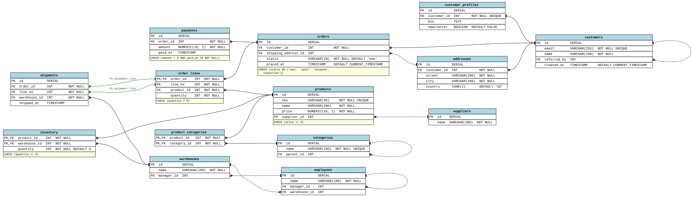

# Schema Diagram

Turns a SQL schema file into a diagram of its tables, columns, constraints, and relationships, including tables that reference themselves. It reads Postgres, MySQL, SQLite, and SQL Server syntax.

## How it works

The program runs in four stages, each in its own module:

```
schema.sql → tokenizer → parser → model → renderer → Graphviz → diagram.svg
```

1. **Tokenizer** ([`tokenizer.py`](schemadiagram/tokenizer.py)) reads the SQL one character at a time and splits it into tokens: keywords, names, numbers, strings, symbols, and operators. It drops comments and handles each dialect's quoting, like `"name"`, `` `name` ``, and `[name]`.
2. **Parser** ([`parser.py`](schemadiagram/parser.py)) is a hand-written recursive-descent parser, with one method per grammar rule. It reads `CREATE TABLE` and `ALTER TABLE` statements and skips everything else, like views, functions, and `INSERT` data. Anything it can't use becomes a warning instead of an error.
3. **Model** ([`model.py`](schemadiagram/model.py)) holds the result as plain Python `dataclasses`: a `Schema` of `Table`s, each with its `Column`s and `ForeignKey`s. The parser fills it in and the renderer reads it, and neither knows about the other.
4. **Renderer** ([`render_dot.py`](schemadiagram/render_dot.py)) turns the model into Graphviz's DOT language. Each table becomes a node with an HTML-like label, a box with one row per column, and each foreign key becomes an edge between two column rows. Graphviz then lays out the boxes, routes the arrows, and writes the SVG, PNG, or PDF.

## Libraries

- **[Graphviz](https://graphviz.org/)** does the layout and drawing. It's a separate program, and the [`graphviz`](https://pypi.org/project/graphviz/) Python package calls it.
- **Python's standard library** does the rest: `dataclasses` and `enum` for the model and token types, `re` and `textwrap` for text handling, `argparse` for the command line, `pathlib` for files, and `webbrowser` for `--open`.
- **[pytest](https://pytest.org/)** runs the tests and **[ruff](https://docs.astral.sh/ruff/)** checks the code style. Neither is needed to run the program.

No SQL parsing library is used. The tokenizer and parser are written from scratch.

## Setup

Requires Python 3.12+ and [Graphviz](https://graphviz.org/download/). On Windows, install Graphviz with `winget install --id Graphviz.Graphviz -e`.

```bash
python -m venv .venv
.venv\Scripts\activate
pip install -e .
```

## Usage

```bash
diagram path/to/schema.sql
```

If Windows blocks `diagram.exe`, run `python -m schemadiagram path/to/schema.sql` instead; it works the same way.

This writes `out/schema.svg`. Add `--open` to open it when it's done, or use `-o` to choose another location or format, like `-o shop.png`. Anything it has to skip is printed as a warning.

To run the tests:

```bash
pytest
```

## Example

From [`examples/store.sql`](examples/store.sql):

```sql
CREATE TABLE customers (
  id SERIAL PRIMARY KEY,
  email VARCHAR(255) NOT NULL UNIQUE,
  name VARCHAR(100) NOT NULL,
  referred_by INT REFERENCES customers(id),   -- self-reference, optional
  created_at TIMESTAMP DEFAULT CURRENT_TIMESTAMP
);

-- One-to-one: UNIQUE means each customer has at most one profile.
CREATE TABLE customer_profiles (
  id SERIAL PRIMARY KEY,
  customer_id INT NOT NULL UNIQUE REFERENCES customers(id) ON DELETE CASCADE,
  bio TEXT,
  newsletter BOOLEAN DEFAULT FALSE
);
```

`diagram examples/store.sql` draws the whole 14-table file:



Each row shows `PK` or `FK`, the column's name and type, and constraints like `NOT NULL` and `DEFAULT`. `CHECK` rules go in the yellow footer. A crow's foot marks the "many" end of a relationship and a bar marks the "one" end. Dashed lines are optional relationships, and colored lines with a label are a foreign key spanning several columns.
